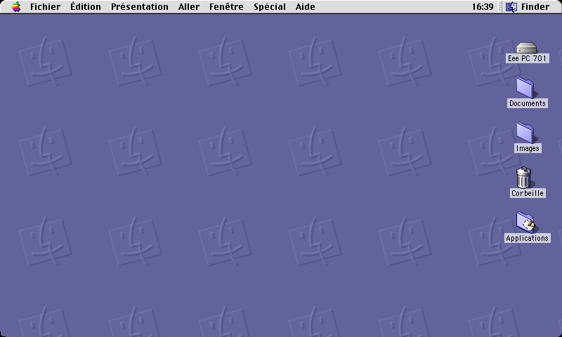
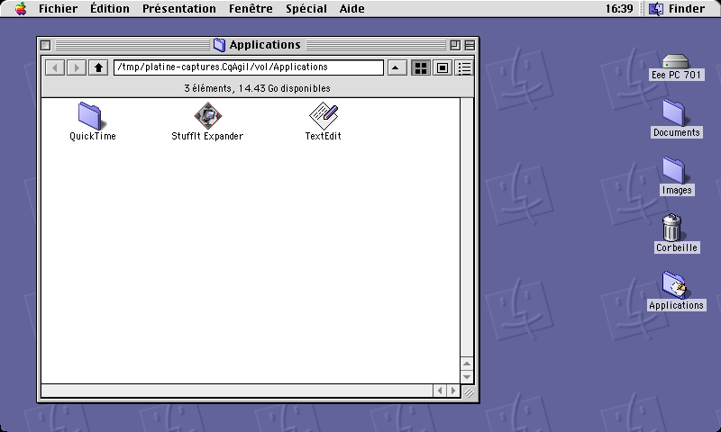
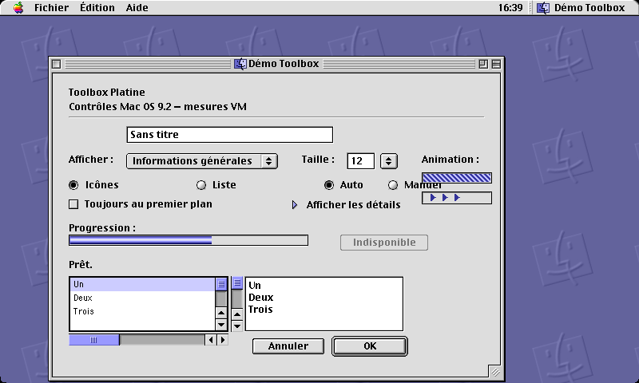
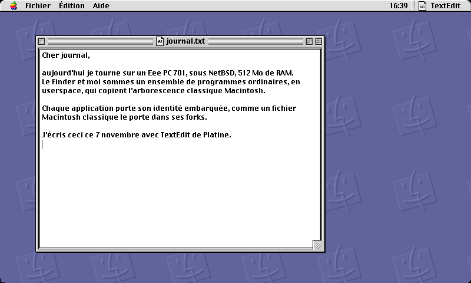
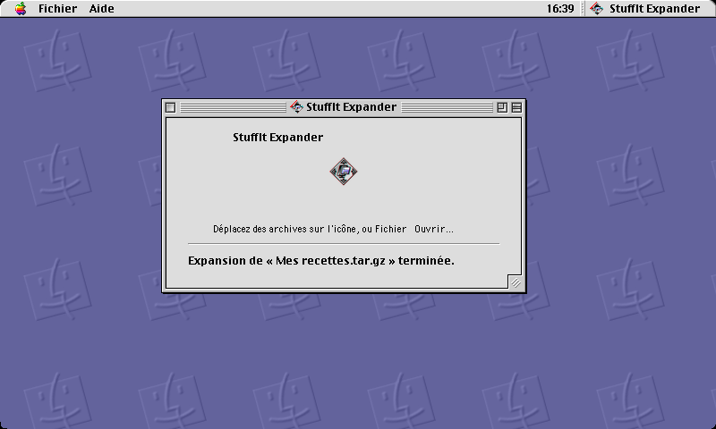
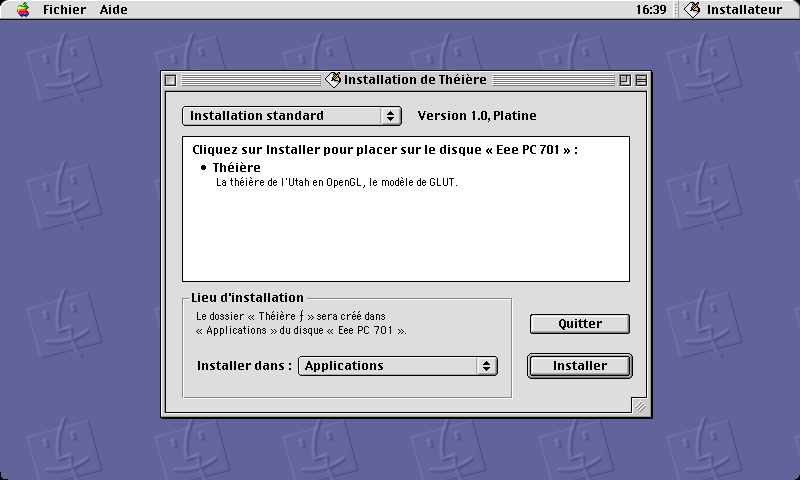

# Platine — a Mac OS 9-style complete desktop environment

**Made in France.** Platine is a complete desktop environment for a small,
old laptop: a window manager, a Finder and a set of applications, written in
C against plain X11, whose look and behavior are modeled on Mac OS 9 down to
one-pixel fidelity. It runs entirely in userspace and takes care to reproduce
the classic Macintosh folder tree. Its test bed and target is an ASUS Eee PC
701 4G (Intel Celeron M 900, 512 MB, 800×480 screen, 4 GB SSD) running
NetBSD 11.1 i386.

> Documentation of record is written in French (`README.fr.md`). The English
> and Esperanto versions are on the roadmap.

Please read [`NOTICE.md`](NOTICE.md) first: anything derived from Mac OS 9 —
the icon packs, the desktop pattern, the fonts and the interface sounds that
the desktop loads at runtime, hosted here in `assets/`, `systeme/polices/`,
`systeme/curseurs/`, `systeme/themes/` — is Apple property, kept for the
owner's strictly personal use, and must never be reused or redistributed.

---

## What Platine is

Platine is **not a theme**. It is a self-contained software platform:

* `platine-wm` — the window manager, with the global menu bar (20 px, bold
  system font, clock at the right, the Apple-style logo menu at the left and
  the application menu at the right), the Platinum title bars with their
  close/zoom/collapse boxes, focus, resizing, zooming, shade, stacking and
  window destruction, plus the system services: logout/restart/shutdown with
  application confirmation, and screen-capture shortcut (⌘⇧3);
* `libptk` (the "Toolbox", in `toolbox/`) — the drawing and events kit shared
  by every program: buttons, checkboxes and radio groups, text fields and
  scrolled lists, scrollbars (Smart Scrolling on hold), slider, tabs, list
  and text view groups, details triangle, indeterminate progress bar (the
  animated stripes), Sherlock-style chasing arrows, beveled buttons, Standard
  File-like open/save dialogs, folder-selection dialog, alerts with splash
  animations, and an interface-sound engine (Appearance codes) driving any
  player backend;
* `platine-finder` — a full Finder: an iconic desktop backed by a real folder
  (`~/Bureau`, Mac OS 9's invisible Desktop Folder) with the startup disk and
  the Trash fixed on it, rounded screen corners, spatial folder windows,
  selection and rubber banding, native drag-and-drop and XDND with X11
  clients in both directions, documents dropped on an application (or its
  alias) open with it, spring-loaded folders, copy and cut/paste of files
  through the X11 clipboard, Trash with restore, aliases,
  `type`/`creator` metadata readable in "Get Info", per-family document
  icons, list view with sortable headers, Mac-OS-9 icon grid rules (Always
  snap/Clean up/Arrange), persistent window geometry, keyboard navigation and
  contextual menus;
* applications shaped like their Mac OS 9 counterparts:
  * **TextEdit** — UTF-8 documents opened by the Finder, save flow, the
    classic "save changes?" closing alert;
  * **Calculator**, **Note Pad** (Stickies), **Key Caps**, **Apple System
    Profiler** — placed exactly where Mac OS 9.2 places them;
  * **Snapz-style screen capture** (**Instantané**, ⌘⇧3): freezes the screen,
    then offers Full screen / Window / Selection, target folder or clipboard,
    greyscale/bitmap, scaling, PNG/PPM, cursor capture — in fact a Control
    Strip module that other programs can install;
  * **QuickTime Player** recreation (`platine-quicktime`): brushed-metal
    window, timeline and transport buttons, decoding delegated to `mplayer`
    in slave mode, one-instance behavior;
  * **StuffIt Expander** recreation (`platine-expander`): archives are
    expanded beside themselves; tar/gzip/bzip2/xz through the base tools,
    external decoders for zip/7z/rar/`sit` (unstuff), plus BinHex 4 `.hqx`
    and MacBinary III `.bin` decoded in C, and the archive they carry
    (typically a `.sit`) is expanded again, exactly like the original;
    anything that is not an archive — a document, a folder, an alias — is
    compressed beside itself instead, as Expander did with DropStuff
    installed (`name.tar.gz`); items are dropped on its icon, on its window
    (XDND) or opened from the Finder;
  * **Theière** — a Utah teapot in OpenGL/GLX written without GLUT or GLU,
    60 frames per second for 26 % CPU on the i915GM, with rotation, drag and
    a title line showing the engine and FPS;
  * **Installer** (`platine-installateur`), modeled after Installer VISE:
    self-contained installers (read-me, license, standard/custom/uninstall
    modes, per-component destinations, destination folder with `Other…`,
    progress with Stop, "Add to the Apple menu" checkbox, extends at the end),
    packaged with `outils/faire-installateur.sh`.

The control panels (the "Tableaux de bord") live in `platine-tableau` with
Mac OS 9 iconography: Appearance (colors, fonts, smoothing, sound theme),
Keyboard, Mouse, Monitor, Dictionary, Control Strip, Date & Time (timezone
editing, network time), Energy Saver (DPMS, lid, power button). The Control
Strip reloads its modules at hot, including modules installed as files.

### The Toolbox, compared with QuickDraw and the Mac Toolbox

On a Mac, the interface of the system is drawn in layers: **QuickDraw**
measures and draws (graphics ports, patterns, rectangles and runs of text,
regions), and on top of it the **Toolbox** — Window Manager, Control Manager,
Dialog Manager, Menu Manager, Event Manager — turns those calls into widgets,
dialogs, menus and the single event loop every application shares.

Platine adopts the same architecture, translated to X11:

* `toolbox/ptk.c` is the QuickDraw stand-in. It is a thin paint layer above
  X11: `ptk_fill`, `ptk_line`, `ptk_rect`, `ptk_clip`, patterns and bevels
  drawn frame by frame from the reference installation — anything done to a
  single pixel is done with one XFillRectangle on purpose. It holds what a
  GrafPort would hold: the palette of the system (loaded once into the `Ptk`
  struct, with the exact colors measured on the reference machine), a
  window-background pattern, the inactive state (disabled control, window in
  background) that every drawing primitive respects, and the fonts of the
  system (Xft on top of fontconfig, chosen once at startup: the menu font,
  the view font, the title font and their italic variants). What QuickDraw
  did with its 8-bit graphics port and its resources, `ptk.c` does with GCs,
  a palette and off-screen pixmaps — the *appearance* is copied from the
  reference machine, the code is our own.
* `toolbox/ptk_app.c` is the Control, Dialog, Menu and Event Manager
  stand-in (about 3,500 lines). There is one event loop per application
  (`ptk_app_run`, `ptk_app_run_modal`), one event callback per window, and
  controls installed on a window where the topmost control under the cursor
  answers — the Control Manager model again, with plain pointers instead of
  `ControlRef`s, and the same state machine TrackControl runs for a control
  that tracks the mouse down, moves, holds and releases (repeat-on-hold,
  keyboard flash). Text editing inside fields, dialogs with default and
  cancel buttons, radio groups, list keyboard navigation and clipboard
  publishing happen *in the Toolbox*, not in the applications — the way the
  Mac did it.
* The layered organization matters more than the names. Because the loop,
  the focus ring, the clipboard and the sounds live in one shared library,
  every Platine program behaves the same: an idle program costs nothing
  beyond its own windows (no polling, a single `select()` deadline for
  caret blinking, repeats and the barber pole), an animated control marches
  at the same stride in every application of the desktop, and a test can
  drive a program like a user would (xdotool) without touching its code.

What the mainstream widget toolkits (GTK, Qt, FLTK) do differently — and why
they did not fit: they own their own drawing and event model (a second
layer above the one the desktop runs), they pick an appearance from a theme
file far from the system they are on, and each window carries its own way of
holding focus, text editing and menus. Platine wants the Mac model — *the
loop belongs to the application, the chrome belongs to the window manager,
the controls answer anything the user does to them* — and `libptk` weighs
about 7,300 lines in total for what this list describes, small enough for
the 701.

In short: where the Mac author wrote `CreateRootControl` and waited on
`WaitNextEvent`, a Platine application writes `ptk_control_add` and returns
from `ptk_app_run` only when its last window has closed. Everything else —
positions, colors, fonts, sounds, keystrokes, clipboards — is our own code,
which borrows the Apple *ideas*, never Apple symbols or resources.

### Userspace, and the classic Macintosh tree

Nothing of Platine is in the kernel, and nothing of it hides in `/usr`: the
desktop is a plain X session (`startx`/`.xinitrc`), programs are ordinary
user binaries, and the few privileged actions (date & time, screen
brightness, reboot, shutdown) go through one small setuid helper
(`platine-privilege`) that whitelists actions and validates arguments.

The disk "Eee PC 701" is the root of the file system, and Platine sits on it
the way Mac OS X sat on BSD (decision D11, measured on a Snow Leopard VM):
**English folder names on disk, safe for the shell, shown in French by the
Finder**, and the BSD folders of the root hidden — the disk window shows only
four folders:

```
/                          "Eee PC 701"
├── Applications/          Théière, TextEdit, StuffIt Expander, QuickTime/, Utilities/
├── System/                shown "Système": Finder, Système (the WM), Extensions/,
│                          Control Panels/, Apple Menu Items/ (the Apple menu reads
│                          it), Startup Items/, Control Strip Modules/, Fonts
├── Library/               shown "Bibliothèque": Desktop Pictures
├── home/                  shown "Utilisateurs": Desktop (the Desktop Folder, shown
│                          "Bureau"), Documents, Downloads, Pictures, Music, Movies
└── bin, etc, usr, var…    hidden by the Finder
```

Each program lives in that tree as a real binary with an **embedded
identity** (an ELF `.platine` section: name, signature, icon, version,
document types) which the Finder reads to display its icon, its "application"
kind, its version, and to open its documents; the Apple menu shows the
contents of `Éléments du menu Pomme`. The BSD side (`/opt/platine`) keeps
only the session scripts, the privilege helper, the font configuration and
the assets that the window manager and the panels need. 
### Screenshots

The real screenshots below are taken inside a throwaway Xvfb by
`outils/captures-publiques.sh`, loading the Apple-derived assets that are
part of this repository (the desktop pattern, the icon packs, the fonts):
this is what the desktop actually looks like. They are published under the
same strictly-personal rule as the assets themselves — Apple property, no
reuse (see `NOTICE.md`).

| The Finder desktop | The Applications folder |
|:---:|:---:|
|  |  |
|  |  |
|  |  |

Left: the Finder desktop with the classic volume icons at the right edge of
the screen. Right: the Applications folder opened as a spatial window, its
files showing their icons drawn by the system (TextEdit binary, StuffIt
Expander binary, QuickTime folder). Then the Toolbox demo panel, TextEdit
with a document, the Expander after expanding an archive beside itself, and
the Installer on its main screen with the destination popup.

## Why NetBSD

The reference environment is a 900 MHz i686 with 512 MB of RAM and a 4 GB
SSD. NetBSD 11.1 i386 is the reference operating system; the tracks that
differ from the base are quarantined in `toolbox/ptk_sys.h` and
`outils/construire-netbsd.sh`, and a Linux/musl tree (Alpine) remains
supported for the same sources — the historical proof that the project builds
outside NetBSD too.

The choice rests on observed facts:

1. **The OS has to disappear under the machine.** The measured desktop (X +
   WM + Finder + Control Strip + OSD) reaches **41.8 MiB RSS** on the running
   session; opening the Apple menu takes **21–26 ms** (target: ≤ 50 ms from
   click to response) and the Finder desktop draws in **153 ms**
   (`outils/mesures-701.sh`). The whole desktop must stay under 96 MiB and
   must leave the 4 GB SSD to the user's files: NetBSD contributes a light,
   predictable base while shipping its own X server and toolkit in
   `/usr/X11R7`, so the project does not drag an ecosystem with it.
2. **Nothing stands between the project and the kernel.** No systemd, no
   opinionated packaging machinery to wrestle: classic `rc.d`, `powerd`
   bridging the lid and the power button to the WM, and plain `sh` scripts
   for the session. The build uses no `pkg-config` and no GNU make:
   `outils/construire-netbsd.sh` compiles with the stock cc against the stock
   headers, which also keeps every tool of the project available on a
   machine without a compiler (the 701 itself is exactly that).
3. **A stable, documented system surface.** What the panels read — battery,
   sound, network, machine identity — is served by base utilities with
   published semantics (`sysctl -n machdep.dmi.*`, `envstat`/`acpibat0`,
   `audioctl`, `mixerctl`, `ifconfig`). No kernel work is needed: the
   i915GM graphics are accelerated out of the box, the Atheros AR2425 Wi-Fi
   works with the base `wpa_supplicant`, HDA audio, battery and lid behave
   themselves, and suspend exists when one asks for it.
4. **The cadence matches the project.** A desktop that imitates a 1999
   system deserves an operating system that does not move under its feet.
   NetBSD's long and boring release cycle is the right environment for a
   project whose user model is "it should still look like this in ten
   years", and its licence and small userland make the whole stack easy to
   audit.

In practice: build on PC, test in Xvfb, deploy with
`outils/installer-netbsd.sh` (compile inside a small NetBSD VM, install on
the 701), reboot the 701, and verify on the real session — plus
`outils/mesures-701.sh` and a VNC preview (`tests/vnc-701.sh`) that never
touch it.

## Repository layout

```
platine/
├── Makefile            make, make test (Xvfb scenarios), make clean
├── toolbox/            the Toolbox (`libptk`) and its GL rules; see README inside
├── src/
│   ├── wm/             the window manager and the global menu bar
│   └── apps/           finder, textedit, theiere, quicktime, installateur,
│                       expander, instantane, strip, tableau, calculette,
│                       pensebetes, keycaps, profileur, …
├── systeme/            session scripts, privilege helper, fonts config, ACPI,
│                       control-panel installer content & manifests
├── tests/              Xvfb scenarios (run-*.sh), VNC preview, 701 measures
├── docs/               specifications, decisions, roadmap (in French)
├── docs/img/public/    the published screenshots (taken with the assets)
├── assets/             Apple-derived desktop assets: icons, pattern, fonts,
│                       sounds — Apple property, strictly personal (NOTICE.md)
├── outils/             deployment, installer packaging, asset preparation,
│                       Mac OS 9 "oracle" scripts (VM-based pixel checks)
├── NOTICE.md           Apple assets & trademark notice — read it first
└── README.fr.md        the original French documentation
```

## Build & tests

On any X-capable host:

```sh
make                    # builds every program into build/
make test               # 29 scenarios inside a throwaway Xvfb (throwaway HOME)
./tests/apercu.sh start # live preview in a Xephyr window (800×480)
```

Build dependencies: Xlib, Xft, Xpm, fontconfig, Xvfb, Xephyr/xdotool, ImageMagick
(`convert`, `import`), zlib. The NetBSD build needs none of those tools beyond
the base cc and X includes (`outils/construire-netbsd.sh`).

On the 701 (NetBSD):

```sh
./outils/installer-netbsd.sh      # cross-compile in vm-netbsd, install on the 701
./outils/mesures-701.sh           # memory + reaction times, without touching :0
```

The Apple-derived assets are part of this repository, so a plain clone has
the lot: the desktop loads the real icon packs, wallpapers, bitmap fonts and
interface sounds prepared by `outils/preparer-assets.sh`. Should they be
removed, the desktop still runs and draws neutral chrome in their place —
the code never requires the Apple material, it only looks more faithful
with it (see `NOTICE.md`).

## Roadmap highlights

Milestones still ahead, as tracked in French in `docs/10-feuille-de-route.md`
(the work plan):

* a massive polish of Mac OS 9's deep behavior — icon dynamics (zooms,
  animated returns, highlights), the cursor, file handling — measured on the
  reference VM, starting with the pressed states of checkboxes, radio
  buttons and little arrows;
* a **Mac OS 9 PowerBook VM**, to measure what is specific to laptops (the
  battery control panel, the trackpad, the sound and brightness on-screen
  displays), so that Platine feels at home on any laptop;
* the application switcher at the right of the menu bar, modeled after
  Mac OS 9's; real menus for non-Platine applications;
* native `.sit` reading and writing inside the Expander, S3 suspend
  validation on the 701, a full "boot to desktop" measurement;
* internationalization — the source documentation lives in French
  (`README.fr.md`); **English and Esperanto versions are on the roadmap**
  (this README is the first piece of the English one).

## Publication model

The private tree carries material that is not published under this model —
the extraction work tree `ressources/` (whole Mac OS 9 applications, third
party programs) and the `audit/` folder with the machine audits and the Mac
OS 9 "oracle" screens; they stay untracked on the author's machine (see
`NOTICE.md`). Publishing works from a dedicated snapshot branch:
`outils/publier.sh` recreates the orphan `publication` branch from the tree
of `master` (a single commit, no history) and pushes it to GitHub as
`main`. The Apple-derived assets of the desktop (`assets/`,
`systeme/polices/`, `systeme/curseurs/`, `systeme/themes/`, the real
screenshots) are part of the published tree, under the strictly-personal
rule of `NOTICE.md`.

---

© 2026 Jeremie Lud. Made in France. The source is published for study; the
Apple-derived material that accompanies it is Apple property and is not for
reuse (see `NOTICE.md`). "Apple", "Macintosh" and
"Mac OS" are trademarks of Apple Inc.; Platine is an independent userspace
project, not affiliated with, endorsed by or sponsored by Apple.
