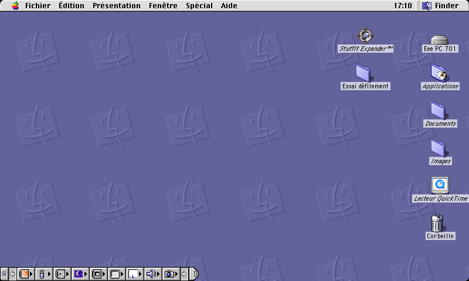
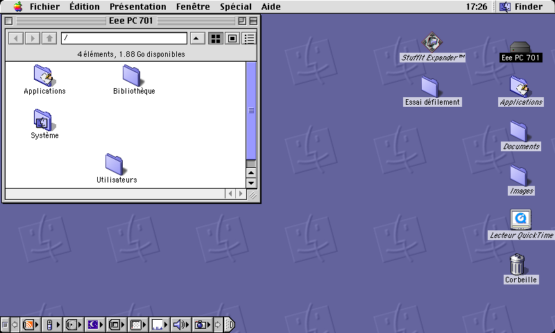
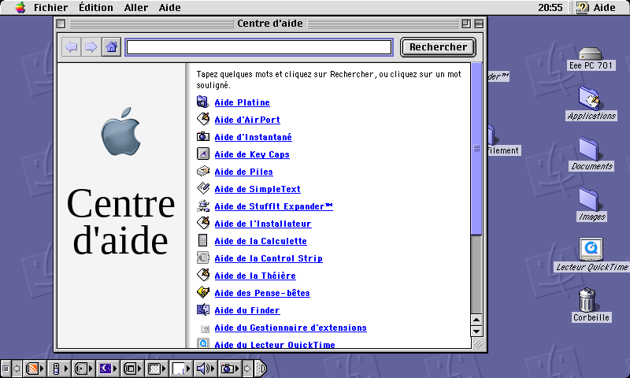
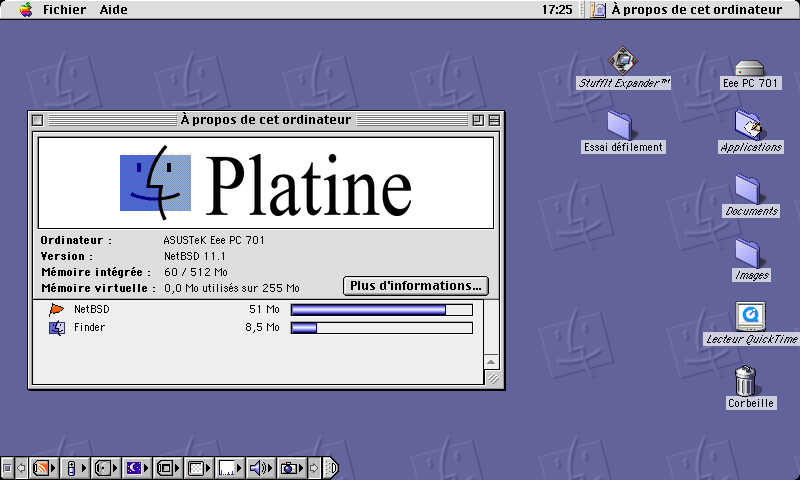
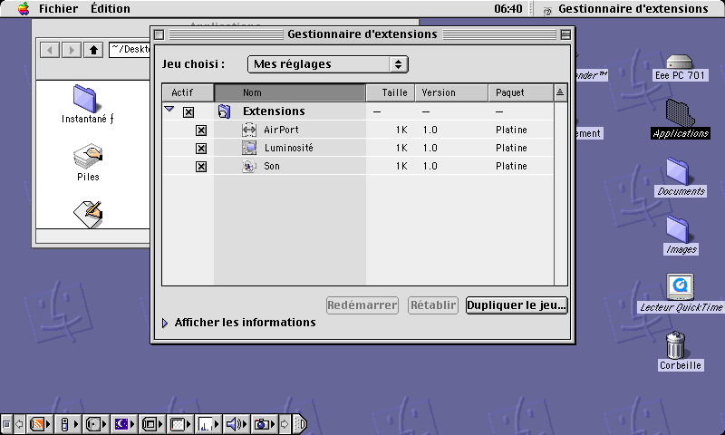
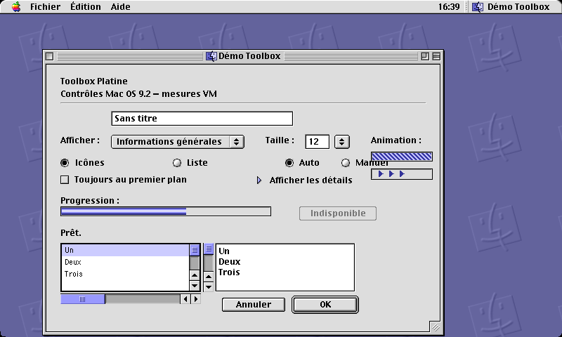

# Platine a déménagé — Platine has moved

**Ce dépôt GitHub n'est plus mis à jour.** Platine vit désormais sur le serveur du
projet ; GitHub renvoie simplement vers le dépôt public.

- **Site :** https://platine.cliquennois.eus/
- **Code source, clonable publiquement :**

```sh
git clone https://platine.cliquennois.eus/repo/platine.git
```

---

## Ce à quoi ressemble Platine — What Platine looks like

Un environnement de bureau à l'image de **Mac OS 9.2.1**, écrit en C, qui tourne
sur de petits ordinateurs anciens (un Eee PC 701 sous NetBSD 11, sans Xorg ni
Wayland). Les captures ci-dessous viennent de la machine réelle.

A desktop environment after **Mac OS 9.2.1**, written in C, running on small
old computers (an Eee PC 701 under NetBSD 11, no Xorg, no Wayland). The
captures below come from the real machine.



*Le bureau : barre des menus, disque et dossiers personnels, Corbeille,
Control Strip. — The desktop: global menu bar, disk and personal folders,
Trash, Control Strip.*

| Une fenêtre du Finder | Le centre d'aide |
|:---:|:---:|
|  |  |

| À propos de cet ordinateur | Le Gestionnaire d'extensions |
|:---:|:---:|
|  |  |


*La Control Strip : chaque module vient d'une extension ou d'un programme. —
The Control Strip: every module comes from an extension or a program.*



*La Démo Toolbox : les contrôles de la bibliothèque commune. — The Toolbox
demo: the controls of the shared library.*

Les assets dérivés de Mac OS 9 (icônes, motif, polices, sons) restent la
propriété d'Apple, pour un usage strictement personnel — voir la NOTICE du
dépôt public. / The Mac OS 9-derived assets (icons, pattern, fonts, sounds)
remain Apple property, for strictly personal use — see the NOTICE in the
public repository.

---

**This GitHub repository is no longer updated.** Platine now lives on the
project's own server; GitHub simply points to the public repository.

- **Website:** https://platine.cliquennois.eus/
- **Source code, public clone:**

```sh
git clone https://platine.cliquennois.eus/repo/platine.git
```

The public repository serves the `publication` branch — the same content this
repository had at the time of the move, refreshed at every release. The
principal repository, with the full history, is private (SSH, held by the
author).
